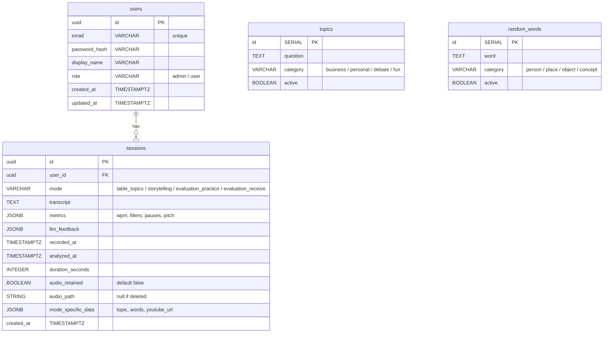

# SpeakNara — Database Schema

## ER Diagram



## Tables

### users

| Column | Type | Notes |
|--------|------|-------|
| `id` | `UUID` | Primary key, default `gen_random_uuid()` |
| `email` | `VARCHAR(255)` | Unique, indexed, used for login |
| `password_hash` | `VARCHAR(255)` | bcrypt hash (managed by Supabase Auth) |
| `display_name` | `VARCHAR(100)` | Shown in UI |
| `role` | `VARCHAR(20)` | `'admin'` or `'user'`, default `'user'` |
| `created_at` | `TIMESTAMPTZ` | Default `now()` |
| `updated_at` | `TIMESTAMPTZ` | Updated on change |

> **Note:** Supabase Auth handles the actual auth tables (`auth.users`, `auth.sessions`). The `users` table here is our app-level profile linked to Supabase via the `id` (UUID).

### sessions

| Column | Type | Notes |
|--------|------|-------|
| `id` | `UUID` | Primary key, default `gen_random_uuid()` |
| `user_id` | `UUID` | FK to `users.id`, indexed |
| `mode` | `VARCHAR(30)` | One of: `table_topics`, `storytelling`, `evaluation_practice`, `evaluation_receive` |
| `transcript` | `TEXT` | Full text of the speech |
| `metrics` | `JSONB` | `{ "wpm": 120, "filler_count": 5, "filler_per_minute": 2.5, "pause_count": 3, "avg_pitch_hz": 150, "pitch_range_hz": 40 }` |
| `llm_feedback` | `JSONB` | `{ "strengths": [...], "improvements": [...], "score": 0.85, "structure": {...}, "rewrites": [...] }` |
| `recorded_at` | `TIMESTAMPTZ` | When recording started |
| `analyzed_at` | `TIMESTAMPTZ` | When analysis completed |
| `duration_seconds` | `INTEGER` | Recording duration |
| `audio_retained` | `BOOLEAN` | Default `false`; if `true`, audio is stored in Supabase Storage |
| `audio_path` | `TEXT` | Path in Supabase Storage bucket (null if deleted) |
| `mode_specific_data` | `JSONB` | Mode-specific: `{ "topic": "..." }` or `{ "words": [...] }` or `{ "youtube_url": "..." }` |
| `created_at` | `TIMESTAMPTZ` | Default `now()` |

### topics (Table Topics prompts)

| Column | Type | Notes |
|--------|------|-------|
| `id` | `SERIAL` | Primary key |
| `question` | `TEXT` | The prompt/question |
| `category` | `VARCHAR(20)` | `business`, `personal`, `debate`, `fun` |
| `active` | `BOOLEAN` | Default `true` |

### random_words (Storytelling word pool)

| Column | Type | Notes |
|--------|------|-------|
| `id` | `SERIAL` | Primary key |
| `word` | `TEXT` | A concrete word |
| `category` | `VARCHAR(20)` | `person`, `place`, `object`, `concept` |
| `active` | `BOOLEAN` | Default `true` |

## Indexes

```sql
CREATE INDEX idx_sessions_user_id ON sessions(user_id);
CREATE INDEX idx_sessions_mode ON sessions(mode);
CREATE INDEX idx_sessions_recorded_at ON sessions(recorded_at);
CREATE INDEX idx_sessions_user_mode_date ON sessions(user_id, mode, recorded_at);
CREATE INDEX idx_users_email ON users(email);
CREATE INDEX idx_topics_category ON topics(category);
CREATE INDEX idx_random_words_category ON random_words(category);
```

## Migration Plan

- Use Alembic for all schema changes
- Initial migration (V1): create all 4 tables + indexes
- Seed data: 50+ topics, 200+ random words (in a separate seed script)

## Notes

- Supabase provides Row Level Security (RLS) — each user can only see their own sessions
- The `users` table is supplementary to `auth.users` (Supabase's built-in auth table)
- JSONB columns for flexible metrics/feedback that may evolve
- `mode_specific_data` avoids creating separate tables for each mode's unique fields
